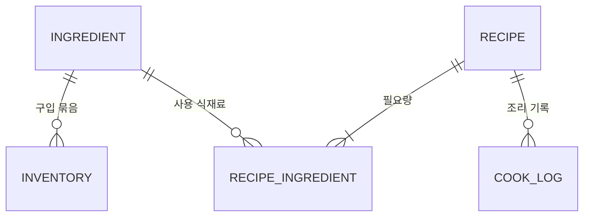

# 자취생 식재료 재고 및 레시피 관리

집에 있는 재료로 **목표 인분을 만들 수 있는지**, 부족하다면 **무엇이 얼마나 부족한지** 알려주는 터미널 프로그램입니다. 같은 식재료도 구입한 묶음마다 남은 양과 소비기한을 따로 기록합니다. 데이터베이스 설계 과제로 개발했으며, 파이썬에서 Oracle Database에 연결해 데이터를 저장하고 조회합니다.

## 동작 예시

김치가 40g 남은 묶음과 소비기한이 미입력인 20g 묶음이 있다면, 조리에 쓸 수 있는 보유량은 60g입니다. 기한이 지난 50g 묶음은 계산에서 제외하고, 기한 미입력 묶음은 결과에 따로 표시합니다.

| 목살 김치볶음밥 | 김치 필요량 | 비교에 쓰는 보유량 | 부족량 |
| --- | ---: | ---: | ---: |
| 1인분 | 100g | 60g | **40g** |
| 2인분 | 200g | 60g | **140g** |

## 주요 기능

| 메뉴 | 할 수 있는 일 |
| --- | --- |
| `1`–`3` 식재료 | 식재료 등록, 이름·분류 검색, 기준 단위 수정 |
| `4`–`7` 재고 | 구입 묶음별 등록, 남은 양 수정, 오늘부터 3일 뒤까지 소비기한 임박 조회 |
| `8`–`12` 레시피 | 레시피 등록·수정, 목표 인분별 필요량과 부족량 확인, 조리 가능한 메뉴 조회 |
| `13`–`14` 조리 기록 | 조리 일시·인분·메모 저장, 날짜 범위·레시피별 조회 |

조리 기록을 저장한 뒤 실제 사용량은 메뉴 `6`에서 묶음별로 반영합니다.

## 실행하기

검증한 환경은 **Windows · Oracle Database 10g XE · Python 3.13(32비트)**입니다. Oracle XE 서비스와 리스너가 실행 중이어야 하고, `Oracle in XE` 32비트 ODBC 드라이버, `sqlplus`, `uv`가 필요합니다. 최초 설정은 Oracle의 로컬 관리 권한으로 실행합니다.

```powershell
git clone https://github.com/Ryoqon-dev/DataBase_design_261120.git
cd DataBase_design_261120
powershell -NoProfile -ExecutionPolicy Bypass -File .\setup.ps1
.\.venv\Scripts\python.exe .\main.py
```

설정 스크립트는 프로젝트 전용 32비트 가상환경을 만들고, `127.0.0.1:1521/XE`에 `PANTRY_APP` 계정과 테이블을 준비합니다. Oracle 설치와 환경 구성이 끝났다면 이후에는 마지막 실행 명령만 사용하면 됩니다.

빈 프로젝트 DB에서 위 예시를 재현하려면 아래 명령을 한 번 실행합니다. 프로그램을 열고 메뉴 `11`에서 목살 김치볶음밥을 선택한 뒤 목표 인분을 입력하면 됩니다.

```powershell
.\.venv\Scripts\python.exe .\main.py --seed
```

직접 데이터를 넣으려면 메뉴 `1`에서 식재료를 등록하고, 메뉴 `4`에서 재고를 추가한 뒤 메뉴 `8`에서 레시피를 만듭니다. 조리 방법 입력은 마침표 하나(`.`)를 별도 줄에 입력하면 끝납니다. 재료 목록 입력은 식재료번호에서 Enter를 누르면 끝납니다.

## 데이터베이스 설계



`RECIPE_INGREDIENT`에 레시피의 기준 인분별 필요량을 저장합니다. 필요량은 `기준 필요량 × 목표 인분 ÷ 기준 인분`으로 계산합니다. 같은 레시피에 동일한 재료가 두 번 들어가지 않도록 복합 기본키를 두었고, 레시피와 재료 목록을 한 트랜잭션으로 저장합니다.

설계 자료는 초기 MySQL 가정을 담고 있습니다. 실제 실행에는 Oracle 10g에 맞춘 SQL 파일을 사용합니다. 식별번호는 시퀀스로 발급하고, 한글 조리 방법을 2,000자까지 입력할 수 있도록 `CLOB`으로 저장합니다.

| 파일 | 내용 |
| --- | --- |
| [`main.py`](main.py), [`pantry.py`](pantry.py), [`db.py`](db.py) | 터미널 메뉴, 기능 로직, Oracle 연결 및 초기화 |
| [`sql/schema.sql`](sql/schema.sql), [`sql/seed.sql`](sql/seed.sql) | 테이블·제약조건·시퀀스, 예시 데이터 |
| [`docs/database-design.pdf`](docs/database-design.pdf), [`docs/database-design.pptx`](docs/database-design.pptx) | 요구사항 32개, ERD, 릴레이션 스키마 및 테이블 명세 |
| [`tests/test_oracle.py`](tests/test_oracle.py) | 실제 Oracle과 연결하는 통합 테스트 |

## 테스트

초기 설정이 끝난 상태에서 실행합니다. 각 테스트의 데이터 변경은 롤백됩니다.

```powershell
.\.venv\Scripts\python.exe -m unittest discover -s tests -v
```

검증 항목에는 묶음별 재고, 소비기한 경계, 외래키와 수량 제약, 한글 조리 방법 저장, 필요량 계산, 조리 기록과 재고 수정이 포함됩니다.
